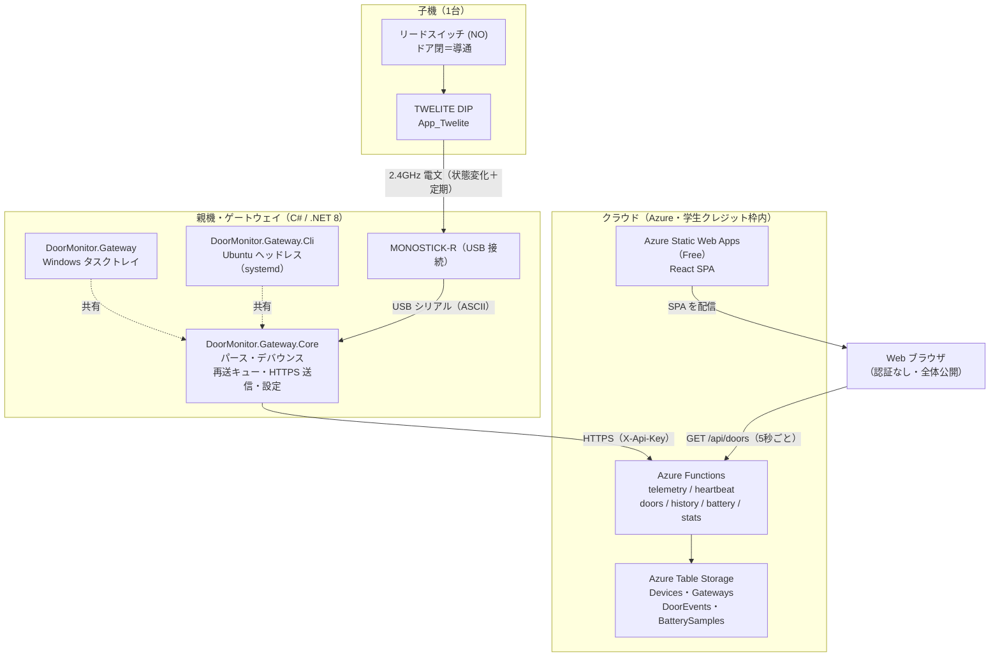
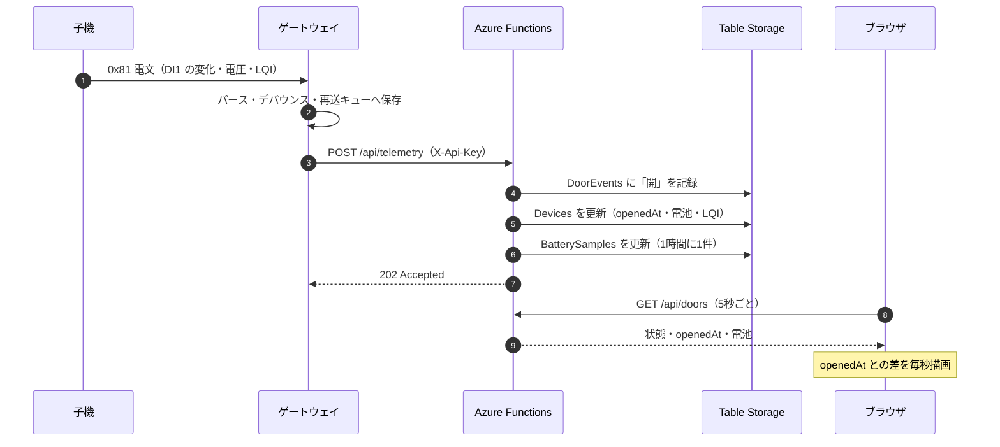

# door-iot

[](https://github.com/nicerice21/door-iot/actions/workflows/ci.yml)
[](LICENSE)
[](https://dotnet.microsoft.com/)
[](https://nodejs.org/)

TWELITE 1 台とリードスイッチでドアの開閉を検知し、PC の常駐ゲートウェイから Azure Functions へ送信、Web ブラウザで状態・経過時間・電池・利用状況を確認するプロトタイプです。

- 設計の正本: [docs/requirements.md](docs/requirements.md)
- 開発・実行手順: [docs/development.md](docs/development.md)
- Azure へのデプロイ: [docs/deployment.md](docs/deployment.md)

## 概要

| 項目 | 内容 |
| :--- | :--- |
| 目的 | ドアの開閉と「開いてからの経過時間」を、認証なしの Web で誰でも確認できるようにする |
| 子機 | TWELITE DIP + リードスイッチ (NO) + 電池。プロトタイプは 1 台 |
| ゲートウェイ | Windows: タスクトレイアプリ（WinForms）／Ubuntu: ヘッドレス（systemd）。受信処理は共通 |
| クラウド | Azure Functions（.NET 8 Isolated）+ Table Storage + Static Web Apps（Free） |
| Web | React + TypeScript。5 秒ごとのポーリングで更新（認証なし・全体公開） |
| 予算 | Azure for Students の無料枠内で運用できる SKU のみ |

## 主な機能

| 機能 | 内容 |
| :--- | :--- |
| **状態表示** | `開` / `閉` / `オフライン`、開いてからの経過時間を毎秒更新（5分で黄・30分で赤） |
| **開閉履歴** | 直近 20 件の開閉と開放時間。カードの「履歴」から表示 |
| **電池電圧** | 1 時間ごとの推移グラフ、最新・最小・平均、低下量から寿命の目安を推定。2.5V 未満で警告 |
| **利用状況** | 開いた回数・平均／最長／合計の開放時間、日別・時間帯別の分布 |
| **死活監視** | 親機（PC）と子機の 2 階層。最終受信としきい値から判定 |
| **再送** | 送信に失敗したテレメトリはローカルに保存し、API 復旧後に受信順で再送 |

## システム構成



- **経過時間**: サーバーは `openedAt`（ISO 8601 UTC）だけを返し、ブラウザが毎秒差分を描画します。ポーリング間隔に依存しません。
- **死活監視**: 親機の最終通信と子機の最終受信を別々に評価し、PC 停止と電池切れ／圏外を切り分けます。

## ドアを開けたときの流れ



## 構成と責務

| プロジェクト | 役割 |
| :--- | :--- |
| `src/DoorMonitor.Core` | ドメインモデル、開閉の状態遷移、デバウンス、死活判定、TWELITE 電文パーサ |
| `src/DoorMonitor.Gateway.Core` | シリアル受信、再送キュー、API 送信、設定（両ホストで共有） |
| `src/DoorMonitor.Gateway` | Windows 用のタスクトレイ UI |
| `src/DoorMonitor.Gateway.Cli` | Ubuntu 用のヘッドレス実行ファイル `doormonitor-gateway` |
| `src/DoorMonitor.Functions` | HTTP API 6 本、Table / InMemory リポジトリ |
| `web` | 状態カード、履歴、電池グラフ、利用統計 |
| `infra/main.bicep` | Azure リソース定義 |
| `scripts/deploy.ps1` | Bicep・Functions・Web をまとめてデプロイ |

<details>
<summary>リポジトリ構成（ツリー）</summary>

```text
door-iot/
├─ .github/workflows/          # ci.yml / release.yml
├─ docs/                       # requirements / development / deployment
├─ infra/main.bicep            # Azure リソース定義
├─ scripts/
│  ├─ deploy.ps1               # デプロイ
│  └─ linux/                   # systemd ユニット
├─ src/
│  ├─ DoorMonitor.Core/
│  ├─ DoorMonitor.Gateway.Core/
│  ├─ DoorMonitor.Gateway/
│  ├─ DoorMonitor.Gateway.Cli/
│  └─ DoorMonitor.Functions/
├─ tests/
│  ├─ DoorMonitor.Core.Tests/
│  └─ DoorMonitor.Gateway.Tests/
├─ web/                        # Vite + React + TypeScript
├─ DoorMonitor.sln
└─ Directory.Build.props
```
</details>

## クイックスタート

### 1. Web 画面だけ動かす（ダミーデータ）

```powershell
cd web
Copy-Item .env.example .env.local
# .env.local の VITE_USE_MOCK を true に変更
npm install
npm run dev
```

### 2. API とつなぐ

Azure Functions Core Tools v4 が必要です。既定はメモリ内リポジトリのため、Table Storage は不要です。

```powershell
Copy-Item src\DoorMonitor.Functions\local.settings.json.example src\DoorMonitor.Functions\local.settings.json
func start --project src\DoorMonitor.Functions
```

### 3. ゲートウェイを動かす

| OS | 実行 | 設定の保存先 |
| :--- | :--- | :--- |
| Windows | `dotnet run --project src\DoorMonitor.Gateway` | `%LOCALAPPDATA%\DoorMonitor\gateway.settings.json` |
| Ubuntu | `dotnet publish src/DoorMonitor.Gateway.Cli -p:PublishProfile=linux-x64` → `./doormonitor-gateway` | `~/.local/share/DoorMonitor/gateway.settings.json` |

- Windows はタスクトレイの「設定...」、Ubuntu は設定ファイルとコマンドライン引数（`--com-port` / `--api-base-url` / `--api-key`）で設定します。
- Ubuntu はシリアルデバイスへアクセスするため、実行ユーザーを `dialout` グループへ追加してください。
- 常駐化（systemd）は [docs/deployment.md 6.2](docs/deployment.md#62-ubuntuヘッドレス--systemd) を参照してください。

## ビルドとテスト

```powershell
dotnet build DoorMonitor.sln
dotnet test tests\DoorMonitor.Core.Tests\DoorMonitor.Core.Tests.csproj
dotnet test tests\DoorMonitor.Gateway.Tests\DoorMonitor.Gateway.Tests.csproj

cd web
npm test
npm run build
npm run lint
```

CI（`.github/workflows/ci.yml`）が .NET・Web・Bicep と Ubuntu 用ゲートウェイのビルドを確認します。

## リリース（ゲートウェイの配布）

`v1.0.0` のようなタグを push すると、Windows と Ubuntu の実行ファイルをビルドして GitHub Release に添付します。

```powershell
git tag v1.0.0
git push origin v1.0.0
```

| OS | 配布物 |
| :--- | :--- |
| Windows | `DoorMonitor.Gateway-vX.Y.Z-win-x64.zip`（exe・README・LICENSE） |
| Ubuntu | `DoorMonitor.Gateway-vX.Y.Z-linux-x64.tar.gz`（実行ファイル・README・LICENSE） |

それぞれ `.sha256` を添付します。exe は署名していないため、Windows では初回起動時に SmartScreen の警告が出る場合があります。

## Azure へのデプロイ

```powershell
# 初回（API キーを指定）
pwsh .\scripts\deploy.ps1 -ApiKey $apiKey

# 2 回目以降（Functions の ApiKey を再利用）
pwsh .\scripts\deploy.ps1 -Target Code
```

Bicep の検証・デプロイ、Web と Functions の配置、`GET /api/doors` の確認までをまとめて実行します。リソースやコスト、カスタムドメインの手順は [docs/deployment.md](docs/deployment.md) を参照してください。

## ドキュメント

| ドキュメント | 内容 |
| :--- | :--- |
| [docs/requirements.md](docs/requirements.md) | 要件定義（設計の正本） |
| [docs/development.md](docs/development.md) | 構成、API、Table の構造、Web、ゲートウェイ、CI |
| [docs/deployment.md](docs/deployment.md) | Azure リソース、デプロイ、systemd、カスタムドメイン |

## 実装範囲と残課題

- **実装済み**: 電文パース、開閉の状態遷移、API 6 本、開閉履歴、電池電圧の履歴・寿命推定・電圧警告、利用統計、Windows / Ubuntu のゲートウェイ、再送キュー、Bicep、デプロイ、実機での通し確認、リリースワークフロー
- **対象外**: 複数台運用、フロアマップ表示、表示メタデータの管理 API/UI
- **残課題（運用上の改善）**: オフライン表示の実機確認、CD の自動化、Timer Trigger による古い履歴の削除、ハートビート欠測の検出

## ライセンス

[Apache-2.0](LICENSE)
