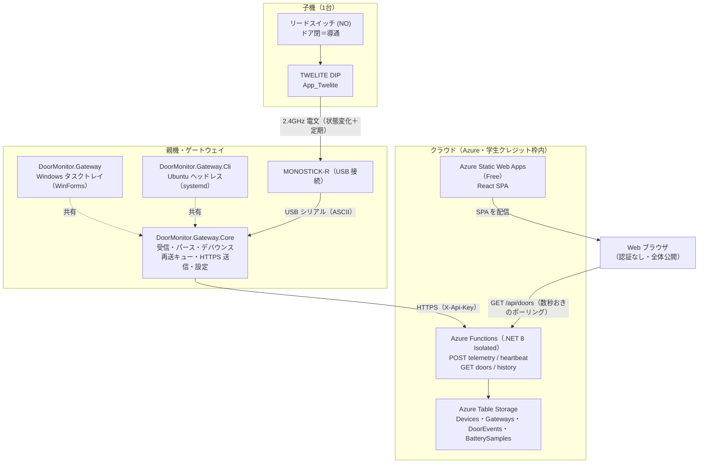

# door-iot

[](https://github.com/nicerice21/door-iot/actions/workflows/ci.yml)

EngineeringDesign入門のプロトタイプ。TWELITE 1台とリードスイッチでドアの開閉を検知し、PC の常駐ゲートウェイ（Windows のトレイアプリ / Ubuntu のヘッドレス版）から Azure Functions へ送信、Web ブラウザで状態・「開いてからの経過時間」・電池電圧と寿命の目安・利用状況を確認するシステムです。

設計の正本は [docs/requirements.md](docs/requirements.md) です。実装の詳細と運用手順は [docs/development.md](docs/development.md) を参照してください。

## システム構成



## リポジトリ構成

```text
door-iot/
├─ .github/
│  └─ workflows/
│     ├─ ci.yml                # GitHub Actions（ビルド・テスト・Bicep 検証）
│     └─ release.yml           # タグ push でゲートウェイを GitHub Release に添付
├─ docs/
│  ├─ requirements.md          # 要件定義（設計の正本）
│  ├─ development.md           # 開発・実行手順
│  └─ deployment.md            # Azure へのデプロイ手順
├─ infra/
│  └─ main.bicep               # Azure リソース定義（IaC）
├─ scripts/
│  ├─ deploy.ps1               # Azure へのデプロイ（Bicep・Functions・Web）
│  └─ linux/                   # systemd ユニット
├─ src/
│  ├─ DoorMonitor.Core/        # 共有モデル・状態遷移・TWELITE パーサ
│  ├─ DoorMonitor.Gateway.Core/ # ゲートウェイ共通処理（シリアル・再送キュー・設定）
│  ├─ DoorMonitor.Gateway/     # Windows 用 WinForms タスクトレイ常駐アプリ
│  ├─ DoorMonitor.Gateway.Cli/ # Ubuntu 用ヘッドレス常駐アプリ
│  └─ DoorMonitor.Functions/   # Azure Functions (C# / .NET 8 Isolated)
├─ tests/
│  ├─ DoorMonitor.Core.Tests/  # xUnit
│  └─ DoorMonitor.Gateway.Tests/ # xUnit（設定・コマンドライン引数）
├─ web/                        # Vite + React + TypeScript
├─ DoorMonitor.sln
└─ Directory.Build.props
```

## 動作確認済みのコマンド

```powershell
# .NET のビルドとテスト
dotnet build DoorMonitor.sln
dotnet test tests\DoorMonitor.Core.Tests\DoorMonitor.Core.Tests.csproj
dotnet test tests\DoorMonitor.Gateway.Tests\DoorMonitor.Gateway.Tests.csproj

# ゲートウェイの単一実行ファイル
dotnet publish src\DoorMonitor.Gateway -p:PublishProfile=win-x64
dotnet publish src\DoorMonitor.Gateway.Cli -p:PublishProfile=linux-x64 -p:DebugType=None -p:DebugSymbols=false

# Web のテストとビルド
cd web
npm install
npm test
npm run build
```

## ローカルで動かす

### Web 画面（ダミーデータ）

```powershell
cd web
Copy-Item .env.example .env.local
# .env.local の VITE_USE_MOCK を true に変更
npm run dev
```

### Azure Functions

Azure Functions Core Tools v4 が必要です。

```powershell
Copy-Item src\DoorMonitor.Functions\local.settings.json.example src\DoorMonitor.Functions\local.settings.json
func start --project src\DoorMonitor.Functions
```

既定ではメモリ内リポジトリ（`Storage__Mode=InMemory`）を使うため、Table Storage を用意せずに API を試せます。Functions ホスト自体のローカルストレージ設定は Core Tools の要件に従ってください。

### PC ゲートウェイ

シリアル受信・再送キュー・API 送信は `DoorMonitor.Gateway.Core` で共通です。ホストだけが違います。

#### Windows（タスクトレイ）

.NET 8 Desktop Runtime がインストールされた Windows で実行します。起動するとタスクトレイに常駐します。

```powershell
dotnet run --project src\DoorMonitor.Gateway
```

単一 exe を作る場合:

```powershell
dotnet publish src\DoorMonitor.Gateway -p:PublishProfile=win-x64
# publish\gateway\DoorMonitor.Gateway.exe
```

COM ポートや API URL はトレイアイコンの「設定...」から変更できます。設定は `%LOCALAPPDATA%\DoorMonitor\gateway.settings.json` に保存されます。

#### Ubuntu（ヘッドレス）

.NET 8 SDK でビルドし、単一実行ファイルを配置します。

```bash
dotnet publish src/DoorMonitor.Gateway.Cli -p:PublishProfile=linux-x64 -p:DebugType=None -p:DebugSymbols=false
# publish/gateway-linux/doormonitor-gateway
```

```bash
./doormonitor-gateway --list-ports
./doormonitor-gateway --com-port /dev/ttyUSB0 \
  --api-base-url https://func-doormon-dev-xxxxxxxxxxxxx.azurewebsites.net \
  --api-key "$API_KEY"
```

- 設定ファイルは `~/.local/share/DoorMonitor/gateway.settings.json` です。初回起動時に既定値で作成されるので、編集してから再実行します。
- シリアルデバイスへアクセスするため、実行ユーザーを `dialout` グループへ追加してください。
- 常駐させる手順は [docs/deployment.md 6.2](docs/deployment.md#62-ubuntuヘッドレス--systemd) を参照してください。

送信に失敗したテレメトリは `%LOCALAPPDATA%\DoorMonitor\queue`（Ubuntu は `~/.local/share/DoorMonitor/queue`）に保存され、API の復旧後に受信順で再送されます。

### GitHub Release への配布

`v1.0.0` のようなタグを push すると、`.github/workflows/release.yml` が Windows と Ubuntu のゲートウェイをビルドし、GitHub Release に添付します。

```powershell
git tag v1.0.0
git push origin v1.0.0
```

- タグは `vX.Y.Z` 形式を推奨します。バージョンは実行ファイルにも反映されます。
- Windows: `DoorMonitor.Gateway-v1.0.0-win-x64.zip`（`DoorMonitor.Gateway.exe`、`README.txt`、`LICENSE`）
- Ubuntu: `DoorMonitor.Gateway-v1.0.0-linux-x64.tar.gz`（`doormonitor-gateway`、`README.txt`、`LICENSE`）
- それぞれに対応する `.sha256` チェックサムを添付します。
- exe は署名していないため、Windows では初回起動時に SmartScreen の警告が表示される場合があります。

## CI とリリース

GitHub Actions（`.github/workflows/ci.yml`）で次を実行します。

- `.NET`: `dotnet build DoorMonitor.sln` と Core / Gateway のテスト、`scripts/deploy.ps1` の構文チェック（`windows-latest`）
- Ubuntu 用ゲートウェイ: `ubuntu-latest` でビルドとテスト
- Web: `npm ci` / `npm test` / `npm run build` / `npm run lint`（`ubuntu-latest`）
- Bicep: `az bicep build` による `infra/main.bicep` の構文検証（`ubuntu-latest`）
- ゲートウェイの単一 exe の publish（`main` への push 時のみ、`windows-latest`）

PR では .NET・Web・Bicep のジョブ結果を確認できます。

タグ `v*` を push すると、`release.yml` が Windows と Ubuntu のゲートウェイをビルドして GitHub Release を作成します。

## Azure へのデプロイ

`infra/main.bicep` で Storage Account / Functions / Static Web Apps / Application Insights を作成します。サブスクリプションに「許可された場所」のポリシーがある場合は `location` に許可リージョンを指定してください。手順とコストの注意は [docs/deployment.md](docs/deployment.md) を参照してください。

`scripts/deploy.ps1` で、Bicep の検証・デプロイ、Web / Functions の配置、API の確認をまとめて実行できます。

```powershell
# 初回（API キーを指定）
pwsh .\scripts\deploy.ps1 -ApiKey $apiKey

# 2 回目以降（既存の API キーを再利用）
pwsh .\scripts\deploy.ps1 -Target Code
```

## 現在の実装範囲

- 実装済み: TWELITE `App_Twelite` 電文パーサ、開閉状態の遷移ロジック、Azure Functions の6 API、ポーリング Web 画面、開閉履歴の表示、電池電圧の履歴・寿命推定・電圧警告、開閉の利用統計、C# トレイアプリ（Windows）、ヘッドレス版ゲートウェイ（Ubuntu）、送信失敗時の再送キュー、Azure リソース定義（Bicep）、Azure へのデプロイ、実機（TWELITE + MONOSTICK）での通し確認、GitHub Release 用のリリースワークフロー（タグ push）
- 1台構成のプロトタイプは完成（2026-11-23）
- プロトタイプの対象外: 複数台運用、フロアマップ表示
- 残課題（運用上の改善）: オフライン表示（電池抜き・PC停止）の実機確認、デプロイの自動化（CD）

## ライセンス

[Apache-2.0](LICENSE)
